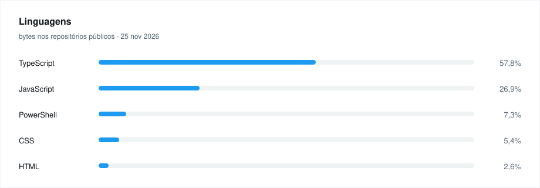
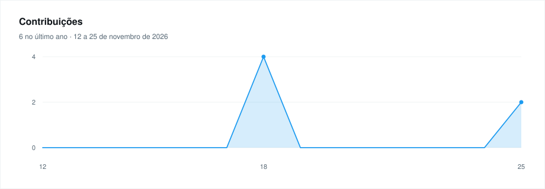

  

<h1 align="center">César</h1>

Aplicações web, do tabuleiro ao servidor.

---

### Sobre

Construo a interface e o servidor no mesmo projeto. A conta fica na aplicação, e a regra do jogo no backend.

 

### Tecnologias

  
  
  
  
  
  
  

### Projetos

[**Royal Chess**](https://github.com/cxsarr7/royal-chess) 
Partidas ao vivo, bots, rating por ritmo, amigos e análise com Stockfish.

[**Vexora**](https://github.com/cxsarr7/vexora) 
Quiz de bandeiras com conta, perfil e amigos.

